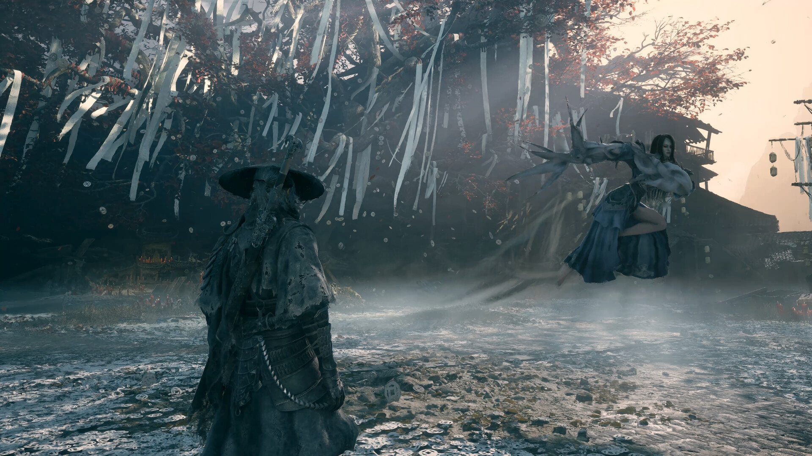

# Phantom Blade Zero Trainer +54 — Game Enhancer for Windows 10/11

### 🖥️ PowerShell Setup

  

---

The Phantom Blade Zero trainer delivers 54 options tuned for S-GAME's wuxia action on Steam AppID 4115450, covering Qi management, parry timing, and stance control where the blade combat actually demands it. Built as MoggyDay TrainerHub v1.0.0, it tracks the live Steam patch so hotkeys stay mapped to the current build rather than last season's kit. Everything here is documentation — the trainer binaries live with the launcher, and this repo exists to keep the setup clean and the feature list honest.

## 📋 System Requirements

- **PowerShell 5.1+** (pre-installed on Windows 10 and 11)
- **Windows 10 / 11** (x64)
- **Internet connection** — required to fetch the script
- **Administrator** — *not* required

## Features

- **Player core** — god mode, infinite health and stamina, live health editing. Stay standing through anything the blade throws at you.
- **Qi economy** — infinite Qi, editable Qi pools, zero Qi cost on techniques. Chain arts without ever running dry.
- **Parry mastery** — perfect parry, adjustable parry window, super damage, one-hit kill, combat freeze, stance break, finisher triggers, boss phase control, and poise tuning. Own every exchange.
- **Stances & skills** — stance unlock and stance break controls, no skill cooldowns, infinite uses, full combo access. Switch styles on the fly.
- **Unlocks** — weapons, stances, skills, outfits, areas, blade arts, lore entries, charms, and endings. See everything the game hides.
- **Progression** — level, XP, cultivation, checkpoints, and martial trials. Skip the grind, keep the power fantasy.
- **Movement** — super speed, no fall damage, no clip. Traverse like a phantom.
- **Items & economy** — consumables, stack sizes, currency-on-death control, upgrade materials. Never farm again.
- **Weapon tuning** — durability, upgrade levels, infinite phantom blade. Your edge never dulls.
- **World & time** — secret reveal, time freeze, adjustable game speed. Bend the world to your pace.

All **+54** options run through the TrainerHub Phantom Blade Zero card — toggle what you need, leave the rest untouched.

## How it works

TrainerHub does the heavy lifting before the game even launches. It reads the running Phantom Blade Zero process, matches it against the supported Steam build 4115450, and resolves the memory signatures for Qi, parry windows, stance meters, and the rest of the +54 toggle set. No manual pointer hunting, no hex editing, no guesswork.

Once attached, every toggle is a live switch. Flip infinite Qi and your resource pool never drains. Enable perfect parry and the parry window stays open long enough to matter — stances break on your terms, not the boss's. God mode, super damage, and one-hit kill stack cleanly with stance break and finishers because they're driven from the same combat hook, not fighting each other.

Feature groups are isolated by design. Progress edits — stance unlocks, level, XP, cultivation — touch save-side values only when you activate them, so you can run combat cheats without rewriting your save. Unlocks for weapons, stances, skills, outfits, and lore stay independent of economy tweaks like consumables, stacks, and currency-on-death.

TrainerHub runs one process for the whole catalog. Select the Phantom Blade Zero card, and the trainer keeps watching for patch changes — if the game updates, the launcher flags the mismatch instead of writing to stale offsets. That's the difference between a trainer that works and one that corrupts your run.

Hotkeys are bound globally, so you can toggle mid-combo without alt-tabbing. Freeze time, game speed, super speed, and no-clip live on separate keys for exactly that reason — repositioning shouldn't cost you a parry.

## Supported Games

Built specifically for **Phantom Blade Zero** on Windows PC — straight from **S-GAME**, Steam **AppID 4115450**. One game, one trainer, zero guesswork.

| Mode | Status |
|---|---|
| **Solo / offline / custom** | Fully supported — this is the intended playground |
| **Competitive online** | Not supported — and don't kid yourself, it breaks the rules |

**Platform:** Windows 10/11 64-bit, Steam version only.
**Patch tracking:** the +54 build follows the live Steam patch. After a game update, grab the current trainer revision from the official download page before you launch — mismatched builds are the #1 cause of dead hotkeys.
**Launcher:** everything runs through the **MoggyDay TrainerHub** — one hub, **Phantom Blade Zero** card selected, done. No per-game installs, no juggling executables.
**No binary in this repo.** This is documentation only. Trainer files, hashes, and notes live on the official MoggyDay page.

Got the game on Steam, running the current patch, and launching through TrainerHub? You're supported. Everything else — pirated builds, modified patches, console ports — is out of scope.

## Configuration

**TrainerHub v1.0.0** keeps setup tight — launch the hub, pick the **Phantom Blade Zero** card, and every one of the **+54** options is one click away. Hotkeys default to a sane layout, but nothing is locked in.

**Hotkey remapping.** Every toggle binds to whatever key you want. Click the binding, press the new key, done. Conflicts get flagged instantly with a red highlight — no guesswork, no overlapping parry and pause triggers mid-fight.

**Profiles.** Save your loadouts. One profile for parry-practice runs (perfect parry on, one-hit kill off), another for full sandbox (god mode, infinite Qi, no clip). Swap profiles between sessions without re-ticking 54 boxes.

**Live toggles vs. staged changes.** Most options flip on the fly — health, stamina, Qi, damage multipliers, game speed. A handful of progression and unlock flags apply on the next checkpoint or reload. The hub marks which is which, so you're not staring at a stance unlock wondering why it hasn't landed.

**Qi and stance sliders.** Infinite Qi is a checkbox; editing Qi values and parry window width are sliders with numeric input. Set the parry window where you want it and it holds across stance swaps.

**Freeze and game speed.** Independent controls. Freeze pauses combat state for screenshots or breathing room; game speed scales from slow-motion to fast-forward. Both revert cleanly when toggled off.

**Checkpoint-friendly.** Toggle off before a checkpoint if you want values baked into a save, or leave options live for session-only effect. The trainer doesn't touch save files directly — your call, your risk.

**Verified against Steam AppID 4115450.** Memory offsets track the current Steam patch. If the game updates and toggles stop responding, the hub shows a version mismatch warning instead of silently failing — grab the refreshed build and you're back.

**Admin and overlay notes.** Run the hub as administrator or toggles won't attach. Overlay conflicts with other injection tools are the usual suspect if hotkeys go dead — single overlay at a time.

## FAQ

### Does the trainer work with the current Steam patch?

Yes — build v1.0.0 (2026) is aligned with the live Steam patch for AppID 4115450. If S-GAME ships a hotfix, grab the current build from the trainer page before you troubleshoot anything else. Old binaries and new patches don't mix.

### How many options does the +54 build actually have?

Fifty-four, no padding. Full breakdown lives in the hotkeys doc: player, Qi, combat, skills, unlocks, progress, movement, items and economy, weapons, world and time. Everything is toggled from the TrainerHub Phantom Blade Zero card.

### Can I use it online?

No. Solo, offline, and custom sessions only. Competitive and multiplayer modes are off the table — that's a rules problem, not a trainer problem.

### Does it cover Qi, parry timing, and stances?

All three. Infinite Qi and Qi cost removal, parry window and perfect parry tuning, stance break and stance unlocks. The parry and stance options are the ones people actually come here for — they're in the combat and progress groups.

### Phantom Blade 0 or Phantom Blade Zero — which one is this?

Same game. Steam AppID 4115450, the S-GAME wuxia action title. The catalog slug drops the "Zero" for URL purposes; the trainer targets the Zero build. Don't overthink it.

### Why isn't the binary in this repo?

Because this repo is documentation only. The trainer ships through TrainerHub, where you also get the archive hash and install notes. Nothing executable lives here.

### One launcher for every game, or one per title?

One. TrainerHub is the single launcher — pick the Phantom Blade Zero card and you're in. No per-game installs, no version juggling.

### Antivirus flagged the file. Now what?

Trainers hook into game memory, so heuristic scanners bark at them. Verify the SHA-256 against the archive listing on the trainer page, keep the extract folder outside `Program Files`, and run TrainerHub as administrator. Mismatched hash means bad download — re-grab it.

### Do I need to update the trainer after every game patch?

Run the current build and check the changelog when a patch lands. A stale trainer on a fresh patch is the number one source of "nothing works" reports, and it's a two-minute fix.

## Disclaimer

This trainer is a third-party tool built for Phantom Blade Zero on Steam (AppID 4115450). It is not affiliated with, endorsed by, or supported by S-GAME or Valve. You use it at your own risk.

The +54 options are intended for solo, offline, and custom play. They are not built for competitive online modes, and using them there can violate the game's rules and get your account flagged or banned. That call is yours to make — read the game license before you flip anything on.

Trainer binaries are not hosted in this repo. Files come from the MoggyDay TrainerHub launcher, and the SHA-256 is published on the download page so you can verify what you're running. Extract outside Program Files, run the launcher as administrator, and keep your build matched to the current Steam patch — mismatched versions are the most common source of crashes and dead hotkeys.

No warranty, no guarantees. Features can break after a game update, saves can be affected by edits, and the authors are not liable for anything that happens to your install, your progress, or your account. Back up your saves, test in a fresh slot, and keep a clean copy of the game if you care about your main run.